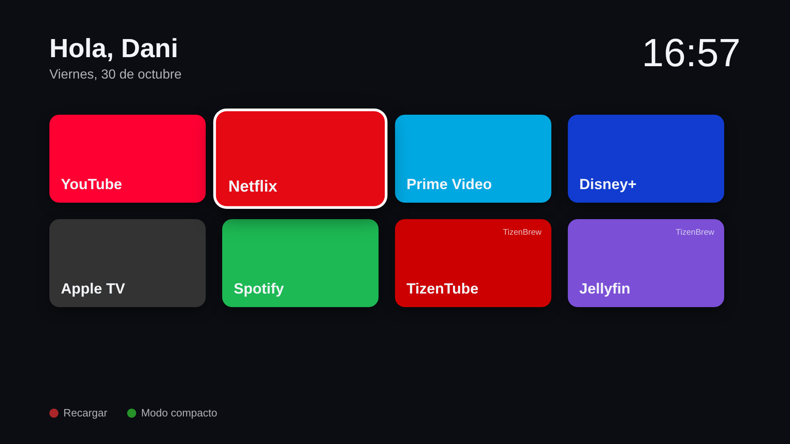

# Dani Launcher

Launcher personal para TVs Samsung (Tizen) que funciona como módulo de [TizenBrew](https://github.com/reisxd/TizenBrew). Muestra una cuadrícula de apps y módulos, el reloj, la fecha y el tiempo, y se maneja con el mando.

## Instalación en la TV

1. Instala TizenBrew siguiendo la guía.
2. Abre TizenBrew y pulsa el botón **verde** para añadir un módulo.
3. Escribe `gh/daniyo25/tiz-n` y confirma.
4. Abre "Dani Launcher" en la lista de módulos.
5. Opcional: márcalo como autolanzamiento en TizenBrew para que se abra al iniciar.

## Mando

| Tecla | Acción |
| --- | --- |
| Flechas | Moverse por la cuadrícula |
| OK | Abrir |
| Rojo | Recargar |
| Verde | Cambiar a modo compacto (6 columnas) |
| Volver | Volver a la pantalla anterior |

## Personalizar

Todo se edita en `app/config.json`:

- `title`: el saludo de arriba.
- `background`: la URL de una imagen de fondo. Si lo dejas vacío, se usa un degradado.
- `weather`: ciudad y coordenadas. El tiempo sale de Open-Meteo, que no necesita clave.
- `tiles`: los accesos. Cada uno tiene `name`, `color` y uno de estos tipos:
  - `tvapp`: una app instalada en la TV. `id` es su ID de Tizen, por ejemplo `3201907018807` para Netflix.
  - `module`: un módulo de TizenBrew. `id` es su nombre completo, por ejemplo `gh/reisxd/TizenTube`.
  - `url`: una web. `id` es la URL.

TizenBrew descarga el módulo a través de jsDelivr, que guarda los cambios en caché hasta 12 horas. Para verlos al momento, publica un tag (por ejemplo `v0.2.0`) y añade el módulo como `gh/daniyo25/tiz-n@v0.2.0`.
